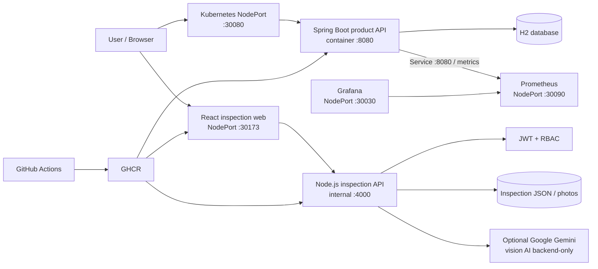
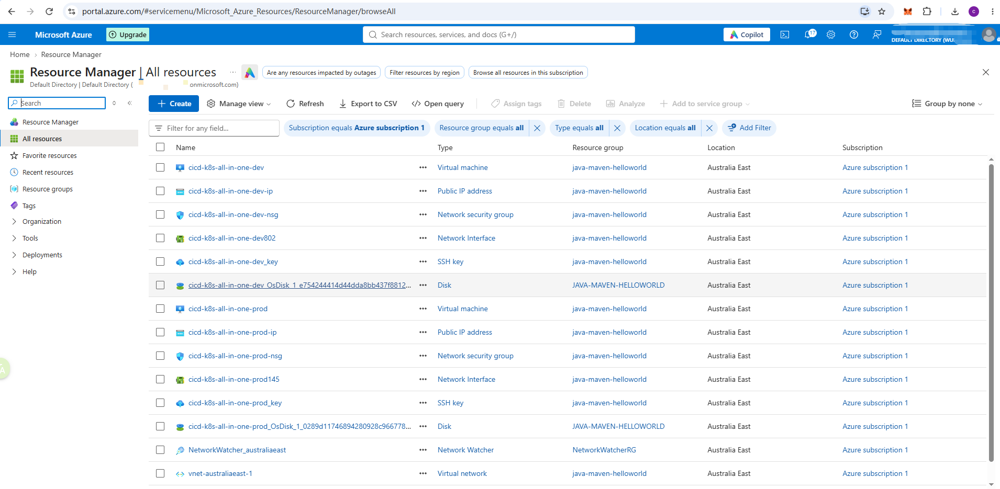
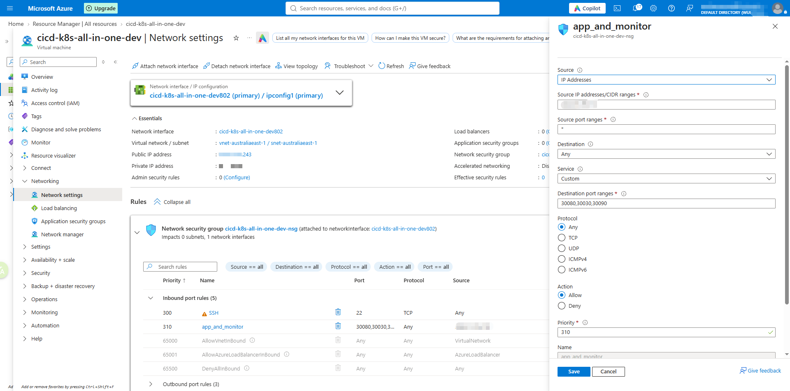
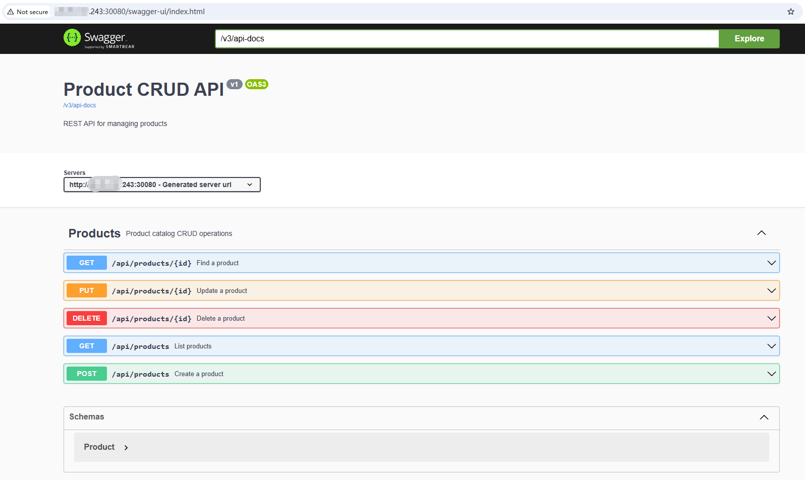
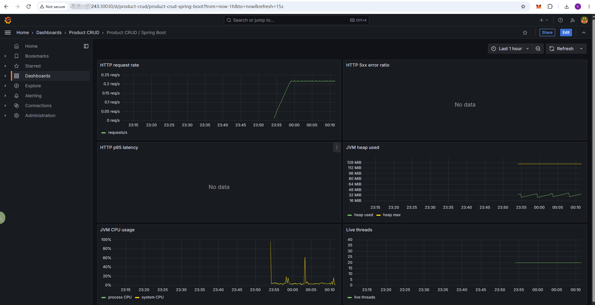
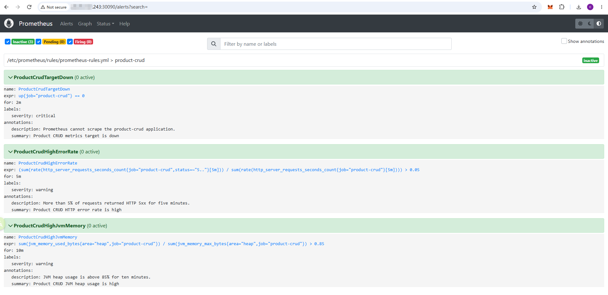

# Spring Boot Maven CRUD Example

[English](README.md) | [简体中文](README.zh-CN.md)

This project demonstrates GitHub Actions CI/CD with two applications:

1. **Spring Boot Product API**: A CRUD application for `Product` records using H2 in-memory database
2. **Passive Fire Inspection Demo**: A Node.js/TypeScript/React application for fire safety inspections with AI-powered assistance via Google Gemini API

## Contents

- [Technology stack](#technology-stack)
- [System architecture](#system-architecture)
- [Screenshots](#screenshots)
- [Run locally](#run-locally)
- [API](#api)
- [Passive fire inspection demo](#passive-fire-inspection-demo)
- [Deployment options](#deployment-options)
- [Recommended hardware](#recommended-hardware)
- [GitHub Actions CI/CD](#github-actions-cicd)
- [Monitoring](#monitoring)
- [Troubleshooting](#troubleshooting)

## Technology stack

**Spring Boot Product API:**
- Java 21, Maven, and Spring Boot 4.1
- Spring Web, Spring Data JPA, and Bean Validation
- Springdoc OpenAPI / Swagger UI
- Spring Boot Actuator and Micrometer Prometheus
- H2, JUnit 6, and MockMvc

**Passive Fire Inspection Demo:**
- Node.js 24, TypeScript 5.9, and Express 5.1
- React 19 with Vite 6.1
- JWT authentication with bcryptjs 3.0
- Multer 2.0 for file uploads
- Swagger UI and swagger-jsdoc for API documentation
- Google Gemini API for AI-powered inspection assistance

**Infrastructure & DevOps:**
- Docker and Docker Compose
- Kubernetes with containerd, kubeadm, kubelet, kubectl, and Flannel
- Prometheus and Grafana for metrics, dashboards, and alert rules
- Azure Virtual Machines and Network Security Groups
- GitHub Actions and GitHub Container Registry (GHCR)

## System architecture

The project can run as an all-in-one single-server stack. The application,
Prometheus, and Grafana are deployed on the same host; Grafana is provisioned
with Prometheus automatically, and Prometheus scrapes the application's
`/actuator/prometheus` endpoint.



Kubernetes is optional for orchestration. On a single Docker host, the
monitoring installer below is idempotent: it installs Docker only when needed,
and reuses existing Prometheus/Grafana containers and persistent volumes.

The original Spring Boot service continues to own the product API. The
inspection demo is a separate React + Node.js vertical slice; the two services
can be deployed independently and share the same CI/CD and monitoring platform.

The product API listens on container port `8080` and uses NodePort `30080`.
The inspection web uses NodePort `30173`; its Node.js API remains an internal
Kubernetes Service on port `4000`. Prometheus uses NodePort `30090`, and Grafana
uses NodePort `30030`. Prometheus scrapes the application metrics while Grafana
reads the metrics from Prometheus and provisions the dashboard automatically.

## Screenshots

The following screenshots show the Azure resources and network configuration
used by the all-in-one deployment, followed by the application and monitoring
interfaces.

### Azure resources



### Azure VM network settings

The Azure Network Security Group allows SSH on port `22`, the product API
NodePort `30080`, the inspection Web NodePort `30173`, and monitoring NodePorts
`30030` and `30090`.



### Swagger UI



### Grafana dashboard



### Prometheus alerts



## Run locally

Requirements: Java 21 and Maven.

```bash
mvn spring-boot:run
```

The application listens on port `8080`. The default profile is `local`, with
Swagger UI and the OpenAPI document available at:

- http://localhost:8080/swagger-ui.html
- http://localhost:8080/v3/api-docs

Select another profile explicitly:

```bash
mvn spring-boot:run -Dspring-boot.run.profiles=dev
mvn spring-boot:run -Dspring-boot.run.profiles=test
java -jar target/product-crud-0.0.1-SNAPSHOT.jar --spring.profiles.active=prod
```

| Profile | Purpose | Swagger |
| --- | --- | --- |
| `local` | Local development with H2 | Enabled |
| `dev` | Shared development environment | Enabled |
| `test` | Automated tests | Enabled |
| `staging` | Production-like environment | Disabled |
| `prod` | Production deployment | Disabled |

Run tests and all quality checks with:

```bash
mvn clean verify
```

This runs tests, Checkstyle, SpotBugs, and PMD.

## API

| Method | Path | Description |
| --- | --- | --- |
| GET | `/api/products` | List all products |
| GET | `/api/products/{id}` | Find one product |
| POST | `/api/products` | Create a product |
| PUT | `/api/products/{id}` | Update a product |
| DELETE | `/api/products/{id}` | Delete a product |

Example request body for create and update operations:

```json
{
  "name": "Keyboard",
  "price": 99.90,
  "description": "Mechanical keyboard"
}
```

Validation rules: `name` is required and limited to 100 characters, `price`
must be greater than zero, and `description` is limited to 500 characters.

## Passive fire inspection demo

The repository also includes a TypeScript/React vertical
slice designed for AI practices under `apps/inspection-api` and `apps/inspection-web`. The existing
Spring Boot product API remains unchanged; the inspection demo is a separate
Node.js service and React application.

The demo supports:

- JWT login with `ADMIN`, `INSPECTOR`, and `VIEWER` roles enforced by the API
- Inspection records with building/location, notes, status, observations, and remedial actions
- JPEG/PNG/WebP photo uploads with a 10 MB per-file and five-file limit
- A printable inspection detail view
- Google Gemini API integration for AI-assisted inspection drafts with a clearly labelled human-review requirement
- A deterministic mock AI suggestion when no provider key is configured

Run the API and web app locally in two terminals:

```bash
cd apps/inspection-api
npm install
copy .env.example .env
npm run dev
```

```bash
cd apps/inspection-web
npm install
npm run dev
```

The API also provides Swagger UI and OpenAPI documentation at:

- http://localhost:4000/api-docs
- http://localhost:4000/api-docs.json

Open http://localhost:5173. Development-only demo accounts are:

| Role | Email | Password |
| --- | --- | --- |
| Inspector | `inspector@example.com` | `Inspector123!` |
| Viewer | `viewer@example.com` | `Viewer123!` |
| Admin | `admin@example.com` | `Admin123!` |

These accounts are disabled when `NODE_ENV=production`; replace them with a
real identity provider before production use. Set `JWT_SECRET` to a long random
secret. AI integration is optional and uses Google Gemini API only: configure
`AI_PROVIDER_URL`, `AI_API_KEY`, and `AI_MODEL` only on the backend; never put
the key in React or commit it.

Run the focused checks:

```bash
cd apps/inspection-api && npm run build && npm test
cd apps/inspection-web && npm run build && npm test
```

Note: For React testing UI mode, ensure `@vitest/ui` is installed (`npm install --save-dev @vitest/ui`).

Run both services with Docker Compose:

```bash
set JWT_SECRET=<long-random-secret>
docker compose -f deployment/inspection/docker-compose.yml up --build -d
```

Docker Compose is provided only as an optional local development shortcut.
It is not the server deployment path: dev, test, staging and production
use the existing Kubernetes deployment and containerd runtime.

## Testing

The project follows a testing pyramid with unit tests (70%), integration tests (20%), and E2E tests (10%).

### API Testing (Node.js/Express)

**Unit & Integration Tests:**
- Framework: Node.js built-in test runner + Supertest
- Location: `apps/inspection-api/test/`
- Run tests: `cd apps/inspection-api && npm test`

Tests cover:
- Authentication and JWT token generation
- Inspection CRUD operations
- Observation management
- Role-based access control

### Frontend Testing (React)

**Component Tests:**
- Framework: Vitest + React Testing Library
- Location: `apps/inspection-web/src/test/`
- Run tests: `cd apps/inspection-web && npm test`
- Run with UI: `npm run test:ui`
- Run with coverage: `npm run test:coverage`

Tests cover:
- Login form and authentication flow
- Role-based UI rendering
- Component interactions
- User actions and state changes

### E2E Testing

**End-to-End Tests:**
- Framework: Playwright
- Install root dependencies (Playwright): `npm install`
- Install browsers: `npx playwright install --with-deps`
- Run tests: `npx playwright test`
- Run with UI: `npx playwright test --ui`
- Location: `e2e/`

**Manual Setup for E2E Tests:**
Before running E2E tests locally, you must start both servers:

1. Terminal 1 - Start API server:
```bash
cd apps/inspection-api
npm run dev
```

2. Terminal 2 - Start web server:
```bash
cd apps/inspection-web
npm run dev
```

3. Terminal 3 - Run E2E tests:
```bash
npx playwright test
```

Tests cover:
- Complete login flow
- Dashboard navigation
- Role-based permissions
- Inspection creation and management
- Cross-browser compatibility (Chromium, Firefox, WebKit)

### CI/CD Integration

The GitHub Actions workflow automatically runs:
- Unit and integration tests on every commit
- Component tests on pull requests
- E2E tests before deployment
- Uploads Playwright reports as artifacts

Test coverage targets:
- Unit tests: 80%+
- Critical business logic: 100%
- E2E: Happy path and key error scenarios

## Deployment options

| Option | Entry point | Runtime | Best for |
| --- | --- | --- | --- |
| Manual JAR | `scripts/manual/` | Java + systemd | Learning host-process deployment |
| Docker | `deployment/docker/`, `scripts/docker/` | Docker Compose | Single-VM container deployment |
| Kubernetes | `deployment/kubernetes/`, `scripts/kubernetes/` | Product API + inspection API/Web + monitoring | Unified container orchestration and rolling updates |
| Monitoring | `deployment/monitoring/`, `scripts/monitoring/` | Prometheus + Grafana | Single-host observability |

GitHub Actions builds the Docker image and publishes it to GHCR. Docker and
Kubernetes deployments use the immutable `sha-<commit>` tag; deployment hosts
do not build a different application artifact.

### 1. Manual JAR deployment

```bash
mvn clean package -DskipTests
scp target/product-crud-0.0.1-SNAPSHOT.jar <user>@<vm>:/home/<user>/app/
scp scripts/manual/deploy.sh scripts/manual/product-crud.service <user>@<vm>:/home/<user>/app/
ssh <user>@<vm> 'bash /home/<user>/app/deploy.sh /home/<user>/app'
```

Check the service:

```bash
sudo systemctl status product-crud
sudo journalctl -u product-crud -f
```

### 2. Docker Compose deployment

Run locally:

```bash
docker compose -f deployment/docker/docker-compose.yml up --build -d
docker compose -f deployment/docker/docker-compose.yml logs -f product-crud
docker compose -f deployment/docker/docker-compose.yml down
```

On a new Ubuntu Docker host, run once:

```bash
sudo bash scripts/docker/install-docker-ubuntu.sh
```

The script is safe to rerun: installed apt packages are skipped and the Docker
repository and service are reused. Log out and back in after being added to the
`docker` group.

The remote deployment script is:

```text
scripts/docker/deploy-docker.sh <app-directory> <image-reference>
```

It logs in to GHCR, pulls the immutable image, recreates the Compose service,
and waits for `/actuator/health`.

### 3. Kubernetes deployment

Kubernetes nodes use **containerd**; Docker is not required and should not be
installed on the Kubernetes server. Installing Docker can replace or reconfigure
the containerd package used by Kubernetes. Use Docker Compose only on a separate
local development machine. Verify the Kubernetes runtime:

```bash
systemctl status containerd kubelet
```

#### Single-node control plane and worker

On the Ubuntu user that will later be used by the CI SSH connection, copy this
repository to the server and run:

```bash
sudo bash scripts/kubernetes/install-kubernetes-ubuntu.sh --init-control-plane
kubectl get nodes
kubectl get pods -A
```

The script installs containerd, kubeadm, kubelet, kubectl, and Flannel; creates
the cluster; and removes the control-plane `NoSchedule` taint so the same node
can run application workloads. It is idempotent: installed dependencies are
skipped and an existing `/etc/kubernetes/admin.conf` prevents a second
`kubeadm init`. During CI deployment, an unreachable cluster automatically
triggers this single-node initialization flow on a new server.

To install packages without initializing a cluster:

```bash
sudo bash scripts/kubernetes/install-kubernetes-ubuntu.sh
```

For a multi-node cluster, initialize the control plane, save the printed
`kubeadm join ...` command, and run it on each worker. Do not remove worker
taints in a multi-node production setup.

Important prerequisites:

- Ubuntu with apt and systemd; run the script with `sudo`.
- The CI SSH user must have passwordless `sudo`; existing multi-node clusters
  must also provide a working `kubectl cluster-info` context.
- The default Pod CIDR is `10.244.0.0/16`; set `POD_NETWORK_CIDR` if it conflicts.
- The default Kubernetes package stream is `v1.30`; set `K8S_MINOR_VERSION` to change it.
- The script disables swap and configures bridge filtering, IPv4 forwarding, and systemd cgroups.
- Allow SSH and TCP `30080`, `30173` in the cloud security group and host firewall.

Verify the node:

```bash
kubectl config current-context
kubectl cluster-info
kubectl get nodes -o wide
kubectl get pods -A
systemctl status containerd kubelet --no-pager
```

#### Manually deploy the Kubernetes application

The deployment script creates the namespace, GHCR pull secret, Deployment, and
Service:

```bash
export GHCR_USERNAME=<github-username>
export GHCR_TOKEN=<read-packages-pat>
bash scripts/kubernetes/deploy-kubernetes.sh \
  /home/<user>/app ghcr.io/<owner>/<repo>:sha-<commit>
```

During CI deployment, if `kubectl` is missing, or if it cannot reach a cluster,
the deployment script automatically runs
`install-kubernetes-ubuntu.sh --init-control-plane` with passwordless `sudo`.
On a new server this creates a single-node cluster, installs Flannel, copies
`admin.conf` to the SSH user's kubeconfig, and removes the control-plane taint.
An existing `/etc/kubernetes/admin.conf` prevents a second initialization.
For an existing multi-node cluster, configure and verify the SSH user's
`~/.kube/config` before deployment instead of relying on automatic
single-node initialization.

The Kubernetes deployment passes the Spring profile selected from the branch:
`dev` uses `dev`, `staging` uses `staging`, and `main` uses `prod`.

`GHCR_TOKEN` requires at least `read:packages`. Do not use the short-lived
`GITHUB_TOKEN` as a long-lived Kubernetes image-pull secret.

#### Deploy the inspection demo in the same Kubernetes cluster

The GitHub Actions Kubernetes job builds and pushes three immutable GHCR images:
the existing Spring Boot product API, the inspection API, and the inspection Web.
It then applies `deployment/kubernetes/inspection.yml` in the same
`product-crud` namespace. The inspection API is internal-only; the React/Nginx
service proxies `/api`, `/health`, and `/uploads` to it.

Configure these additional environment secrets:

| Secret | Purpose |
| --- | --- |
| `INSPECTION_JWT_SECRET` | Long random JWT signing secret |
| `INSPECTION_AI_API_KEY` | Optional backend-only Google Gemini API key |
| `INSPECTION_AI_PROVIDER_URL` | Optional Google Gemini API endpoint |
| `INSPECTION_AI_MODEL` | Optional Google Gemini model name |

`INSPECTION_JWT_SECRET` is required. The three AI secrets may be empty; the
application then uses its review-labelled mock suggestion. The deployment
creates a persistent volume claim for inspection JSON data and uploaded photos.
In the single-node kubeadm setup, the claim is explicitly bound to a local
hostPath volume at `/var/lib/product-crud/inspection-data`, so no default
StorageClass or extra storage provisioner is required. This is appropriate for
the all-in-one demo; use a managed StorageClass or replicated database for a
multi-node production cluster.

The inspection Web is available at:

```text
http://<K8S_VM_IP>:30173
```

Allow TCP `30173` in the Azure Network Security Group and host firewall. The
inspection API must not be exposed as a public NodePort.

#### Access the Kubernetes service

The Service uses NodePort `30080`. Replace `<K8S_VM_IP>` with the node's public
or private IP:

```bash
curl http://<K8S_VM_IP>:30080/actuator/health
curl http://<K8S_VM_IP>:30080/api/products
```

If external access fails, check the cloud security group and host firewall:

```bash
sudo ufw allow 30080/tcp
kubectl -n product-crud get service product-crud
kubectl get nodes -o wide
```

### 4. Prometheus and Grafana monitoring

For Kubernetes, monitoring is deployed as Kubernetes resources by
`scripts/kubernetes/deploy-kubernetes.sh`; Docker is not installed on the
Kubernetes node. The workflow passes `GRAFANA_ADMIN_PASSWORD` from the GitHub
Environment Secret, creates/updates the Kubernetes Secret, and applies
`deployment/kubernetes/monitoring.yml`. Prometheus scrapes the internal
`product-crud:8080` Service, so it does not depend on the external NodePort.

Open Prometheus at `http://<K8S_VM_IP>:30090` and Grafana at
`http://<K8S_VM_IP>:30030`. The application remains available at
`http://<K8S_VM_IP>:30080`. Existing Deployments, Services, ConfigMaps, and
the Grafana Secret are reconciled on every deployment. This learning setup uses
`emptyDir` for monitoring data; deleting the Pods loses metrics history and
Grafana data. Monitoring uses the `Recreate` strategy because this is a
single-node learning cluster; a monitoring Pod is stopped before its replacement
starts. Restrict ports `30030` and `30090` to trusted networks.

The deployment automatically provisions a **Product CRUD / Spring Boot**
dashboard with request rate, HTTP 5xx ratio, p95 latency, JVM heap, CPU, and
thread panels. Prometheus also loads alert rules for an unavailable target,
high HTTP 5xx rate, and high JVM heap usage. These rules are visible under
**Prometheus -> Alerts**; this learning project does not include Alertmanager
or an external notification channel yet.

For a Docker Compose host, deploy monitoring independently after the application
is running:

```bash
export GRAFANA_ADMIN_PASSWORD=<strong-password>
export PROMETHEUS_TARGET=host.docker.internal:8080
sudo -E bash scripts/monitoring/deploy-monitoring.sh /home/<user>/app
```

Docker monitoring is available at `http://<DOCKER_VM_IP>:9090` and
`http://<DOCKER_VM_IP>:3000`. The script is idempotent and uses named volumes
for Prometheus and Grafana data.

## Recommended hardware

The following sizing is for a learning or small internal all-in-one
deployment. It assumes one application instance, H2, 15 days of Prometheus
retention, and light dashboard traffic.

| Usage | CPU | Memory | Storage | Network |
| --- | --- | --- | --- | --- |
| Minimum / demo | 2 vCPU | 4 GB RAM | 30 GB SSD | 5 Mbps |
| Recommended / small team | 4 vCPU | 8 GB RAM | 80 GB SSD | 10 Mbps |
| Higher traffic | 8 vCPU | 16 GB RAM | 150+ GB SSD | 50 Mbps |

Use SSD storage and leave at least 20% free space for container layers,
Prometheus data, and logs. For production workloads, use an external database
instead of H2, separate monitoring from the application host, and size
Prometheus storage from the actual samples-per-second and retention period.

## GitHub Actions CI/CD

The workflow is `.github/workflows/cicd.yml`. Its CI gate validates both the
original Maven application and the TypeScript inspection demo before an image
can be published. The branch-to-environment mapping
is:

| Branch | GitHub Environment | Behavior |
| --- | --- | --- |
| `dev` | `development` | CI on pull requests; build, publish, and deploy on push |
| `staging` | `staging` | CI on pull requests; build, publish, and deploy on push |
| `main` | `production` | CI on pull requests; build and publish on push, then wait for environment approval before deployment |

Pull requests never deploy. Recommended for production: configure `production` with required reviewers in
**Settings -> Environments -> production**; the workflow's deployment job then
pauses until an authorized reviewer approves it. Use environment-level secrets
with the same names listed below so each environment can use its own host and
GHCR credentials. Manual runs can still choose Kubernetes or Docker.

Configure these secrets in each GitHub Environment (using the same names so the
workflow can select the values for the target branch):

| Secret | Purpose |
| --- | --- |
| `K8S_VM_IP`, `K8S_VM_USER`, `K8S_VM_KEY` | Kubernetes SSH deployment |
| `K8S_GHCR_USERNAME`, `K8S_GHCR_TOKEN` | Kubernetes GHCR image pull |
| `DOCKER_VM_IP`, `DOCKER_VM_USER`, `DOCKER_VM_KEY` | Docker Compose SSH deployment |
| `GRAFANA_ADMIN_PASSWORD` | Grafana administrator password for the monitoring deployment |
| `INSPECTION_JWT_SECRET` | Inspection API JWT signing secret |
| `INSPECTION_AI_API_KEY`, `INSPECTION_AI_PROVIDER_URL`, `INSPECTION_AI_MODEL` | Optional backend-only Google Gemini API configuration |

The `publish` job uses the automatically provided `GITHUB_TOKEN` to push the
image. Kubernetes uses the separate `K8S_GHCR_TOKEN` to pull the image. For a
private GHCR package, the PAT needs `read:packages`; if the organization uses
SSO, authorize the PAT for SSO as well.

## Monitoring

The GitHub Actions Kubernetes deployment automatically applies
`deployment/kubernetes/monitoring.yml` after the application deployment.
Store `GRAFANA_ADMIN_PASSWORD` as a secret in each GitHub Environment
(`development`, `staging`, and `production`); no manual password command on
the server is required. The application exposes `/actuator/prometheus`.
Prometheus uses the Kubernetes Service DNS name `product-crud:8080`, not the
external NodePort. For reference, the scrape configuration is:

```yaml
scrape_configs:
  - job_name: product-crud
    metrics_path: /actuator/prometheus
    static_configs:
      - targets: ["product-crud:8080"]
```

Confirm that the target is `UP` under **Prometheus -> Status -> Targets**, then
open the provisioned dashboard under the **Product CRUD** folder. Useful
PromQL examples include:

```promql
sum(rate(http_server_requests_seconds_count{job="product-crud"}[5m]))
histogram_quantile(0.95, sum by (le) (rate(http_server_requests_seconds_bucket{job="product-crud"}[5m])))
sum(jvm_memory_used_bytes{job="product-crud",area="heap"})
up{job="product-crud"}
```

In production, restrict the metrics endpoint to the monitoring host.

## Troubleshooting

### kubectl cannot connect to the cluster

```bash
kubectl config current-context
kubectl cluster-info
kubectl get nodes
```

Make sure these commands run as the SSH user whose `~/.kube/config` is used by
the CI deployment, not as a different user or root.

### ImagePullBackOff

```bash
kubectl -n product-crud get secret ghcr-credentials
kubectl -n product-crud describe pod -l app=product-crud
kubectl -n product-crud get deployment product-crud \
  -o=jsonpath='{.spec.template.spec.containers[0].image}{"\n"}'
```

Confirm that the Secret exists in the same namespace, the PAT has
`read:packages`, and the image tag exists in GHCR.

### Pending

Check node scheduling, available resources, and control-plane taints:

```bash
kubectl get nodes -o wide
kubectl get nodes -o custom-columns=NAME:.metadata.name,TAINTS:.spec.taints
kubectl -n product-crud describe pod -l app=product-crud
```

### CrashLoopBackOff or readiness failures

```bash
kubectl -n product-crud logs -l app=product-crud --all-containers=true --tail=200
kubectl -n product-crud describe pod -l app=product-crud
```

### progress deadline exceeded

This is a summary error meaning that no Pod became Ready before the Deployment
timeout. Inspect Pod events, container logs, and node status instead of only
increasing the timeout:

```bash
kubectl -n product-crud describe deployment product-crud
kubectl -n product-crud describe pod -l app=product-crud
kubectl get nodes
```
