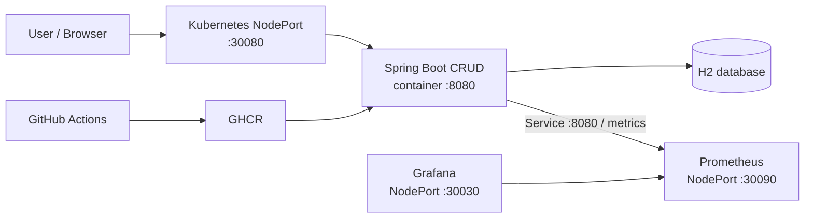

# Spring Boot Maven CRUD Example

[English](README.md) | [简体中文](README.zh-CN.md)

This project is a Spring Boot CRUD application for practising GitHub Actions CI/CD.
It provides create, read, update, and delete operations for `Product` records and
uses an H2 in-memory database, so databases like MySQL are not required.

## Contents

- [Technology stack](#technology-stack)
- [System architecture](#system-architecture)
- [Run locally](#run-locally)
- [API](#api)
- [Deployment options](#deployment-options)
- [Recommended hardware](#recommended-hardware)
- [GitHub Actions CI/CD](#github-actions-cicd)
- [Monitoring](#monitoring)
- [Troubleshooting](#troubleshooting)

## Technology stack

- Java 8 and Spring Boot 2.7
- Spring Web, Spring Data JPA, and Bean Validation
- Spring Boot Actuator and Micrometer Prometheus
- H2, JUnit 5, and MockMvc
- Docker, Docker Compose, and Kubernetes
- GitHub Actions and GitHub Container Registry (GHCR)

## System architecture

The project can run as an all-in-one single-server stack. The application,
Prometheus, and Grafana are deployed on the same host; Grafana is provisioned
with Prometheus automatically, and Prometheus scrapes the application's
`/actuator/prometheus` endpoint.



Kubernetes is optional for orchestration. On a single Docker host, the
monitoring installer below is idempotent: it installs Docker only when needed,
and reuses existing Prometheus/Grafana containers and persistent volumes.

## Run locally

Requirements: Java 8 and Maven.

```bash
mvn spring-boot:run
```

The application listens on port `8080`. The default profile is `local`, with
Swagger UI and the OpenAPI document available at:

- http://localhost:8080/swagger-ui.html
- http://localhost:8080/v3/api-docs

Select another profile explicitly:

```bash
mvn spring-boot:run -Dspring-boot.run.profiles=dev
mvn spring-boot:run -Dspring-boot.run.profiles=test
java -jar target/product-crud-0.0.1-SNAPSHOT.jar --spring.profiles.active=prod
```

| Profile | Purpose | Swagger |
| --- | --- | --- |
| `local` | Local development with H2 | Enabled |
| `dev` | Shared development environment | Enabled |
| `test` | Automated tests | Enabled |
| `staging` | Production-like environment | Disabled |
| `prod` | Production deployment | Disabled |

Run tests and all quality checks with:

```bash
mvn clean verify
```

This runs tests, Checkstyle, SpotBugs, and PMD.

## API

| Method | Path | Description |
| --- | --- | --- |
| GET | `/api/products` | List all products |
| GET | `/api/products/{id}` | Find one product |
| POST | `/api/products` | Create a product |
| PUT | `/api/products/{id}` | Update a product |
| DELETE | `/api/products/{id}` | Delete a product |

Example request body for create and update operations:

```json
{
  "name": "Keyboard",
  "price": 99.90,
  "description": "Mechanical keyboard"
}
```

Validation rules: `name` is required and limited to 100 characters, `price`
must be greater than zero, and `description` is limited to 500 characters.

## Deployment options

| Option | Entry point | Runtime | Best for |
| --- | --- | --- | --- |
| Manual JAR | `scripts/manual/` | Java + systemd | Learning host-process deployment |
| Docker | `deployment/docker/`, `scripts/docker/` | Docker Compose | Single-VM container deployment |
| Kubernetes | `deployment/kubernetes/`, `scripts/kubernetes/` | Deployment + NodePort | Container orchestration and rolling updates |
| Monitoring | `deployment/monitoring/`, `scripts/monitoring/` | Prometheus + Grafana | Single-host observability |

GitHub Actions builds the Docker image and publishes it to GHCR. Docker and
Kubernetes deployments use the immutable `sha-<commit>` tag; deployment hosts
do not build a different application artifact.

### 1. Manual JAR deployment

```bash
mvn clean package -DskipTests
scp target/product-crud-0.0.1-SNAPSHOT.jar <user>@<vm>:/home/<user>/app/
scp scripts/manual/deploy.sh scripts/manual/product-crud.service <user>@<vm>:/home/<user>/app/
ssh <user>@<vm> 'bash /home/<user>/app/deploy.sh /home/<user>/app'
```

Check the service:

```bash
sudo systemctl status product-crud
sudo journalctl -u product-crud -f
```

### 2. Docker Compose deployment

Run locally:

```bash
docker compose -f deployment/docker/docker-compose.yml up --build -d
docker compose -f deployment/docker/docker-compose.yml logs -f product-crud
docker compose -f deployment/docker/docker-compose.yml down
```

On a new Ubuntu Docker host, run once:

```bash
sudo bash scripts/docker/install-docker-ubuntu.sh
```

The script is safe to rerun: installed apt packages are skipped and the Docker
repository and service are reused. Log out and back in after being added to the
`docker` group.

The remote deployment script is:

```text
scripts/docker/deploy-docker.sh <app-directory> <image-reference>
```

It logs in to GHCR, pulls the immutable image, recreates the Compose service,
and waits for `/actuator/health`.

### 3. Kubernetes deployment

Kubernetes nodes use **containerd**; Docker is not required. Install Docker on
the same host only when Docker Compose is also needed. If both are installed,
verify that the container runtime remains healthy:

```bash
systemctl status containerd kubelet
```

#### Single-node control plane and worker

On the Ubuntu user that will later be used by the CI SSH connection, copy this
repository to the server and run:

```bash
sudo bash scripts/kubernetes/install-kubernetes-ubuntu.sh --init-control-plane
kubectl get nodes
kubectl get pods -A
```

The script installs containerd, kubeadm, kubelet, kubectl, and Flannel; creates
the cluster; and removes the control-plane `NoSchedule` taint so the same node
can run application workloads. It is idempotent: installed dependencies are
skipped and an existing `/etc/kubernetes/admin.conf` prevents a second
`kubeadm init`. During CI deployment, an unreachable cluster automatically
triggers this single-node initialization flow on a new server.

To install packages without initializing a cluster:

```bash
sudo bash scripts/kubernetes/install-kubernetes-ubuntu.sh
```

For a multi-node cluster, initialize the control plane, save the printed
`kubeadm join ...` command, and run it on each worker. Do not remove worker
taints in a multi-node production setup.

Important prerequisites:

- Ubuntu with apt and systemd; run the script with `sudo`.
- The CI SSH user must have passwordless `sudo`; existing multi-node clusters
  must also provide a working `kubectl cluster-info` context.
- The default Pod CIDR is `10.244.0.0/16`; set `POD_NETWORK_CIDR` if it conflicts.
- The default Kubernetes package stream is `v1.30`; set `K8S_MINOR_VERSION` to change it.
- The script disables swap and configures bridge filtering, IPv4 forwarding, and systemd cgroups.
- Allow SSH and TCP `30080` in the cloud security group and host firewall.

Verify the node:

```bash
kubectl config current-context
kubectl cluster-info
kubectl get nodes -o wide
kubectl get pods -A
systemctl status containerd kubelet --no-pager
```

#### Manually deploy the Kubernetes application

The deployment script creates the namespace, GHCR pull secret, Deployment, and
Service:

```bash
export GHCR_USERNAME=<github-username>
export GHCR_TOKEN=<read-packages-pat>
bash scripts/kubernetes/deploy-kubernetes.sh \
  /home/<user>/app ghcr.io/<owner>/<repo>:sha-<commit>
```

During CI deployment, if `kubectl` is missing, or if it cannot reach a cluster,
the deployment script automatically runs
`install-kubernetes-ubuntu.sh --init-control-plane` with passwordless `sudo`.
On a new server this creates a single-node cluster, installs Flannel, copies
`admin.conf` to the SSH user's kubeconfig, and removes the control-plane taint.
An existing `/etc/kubernetes/admin.conf` prevents a second initialization.
For an existing multi-node cluster, configure and verify the SSH user's
`~/.kube/config` before deployment instead of relying on automatic
single-node initialization.

The Kubernetes deployment passes the Spring profile selected from the branch:
`dev` uses `dev`, `staging` uses `staging`, and `main` uses `prod`.

`GHCR_TOKEN` requires at least `read:packages`. Do not use the short-lived
`GITHUB_TOKEN` as a long-lived Kubernetes image-pull secret.

#### Access the Kubernetes service

The Service uses NodePort `30080`. Replace `<K8S_VM_IP>` with the node's public
or private IP:

```bash
curl http://<K8S_VM_IP>:30080/actuator/health
curl http://<K8S_VM_IP>:30080/api/products
```

If external access fails, check the cloud security group and host firewall:

```bash
sudo ufw allow 30080/tcp
kubectl -n product-crud get service product-crud
kubectl get nodes -o wide
```

### 4. Prometheus and Grafana monitoring

For Kubernetes, monitoring is deployed as Kubernetes resources by
`scripts/kubernetes/deploy-kubernetes.sh`; Docker is not installed on the
Kubernetes node. The workflow passes `GRAFANA_ADMIN_PASSWORD` from the GitHub
Environment Secret, creates/updates the Kubernetes Secret, and applies
`deployment/kubernetes/monitoring.yml`. Prometheus scrapes the internal
`product-crud:8080` Service, so it does not depend on the external NodePort.

Open Prometheus at `http://<K8S_VM_IP>:30090` and Grafana at
`http://<K8S_VM_IP>:30030`. The application remains available at
`http://<K8S_VM_IP>:30080`. Existing Deployments, Services, ConfigMaps, and
the Grafana Secret are reconciled on every deployment. This learning setup uses
`emptyDir` for monitoring data; deleting the Pods loses metrics history and
Grafana data. Restrict ports `30030` and `30090` to trusted networks.

## Recommended hardware

The following sizing is for a learning or small internal all-in-one
deployment. It assumes one application instance, H2, 15 days of Prometheus
retention, and light dashboard traffic.

| Usage | CPU | Memory | Storage | Network |
| --- | --- | --- | --- | --- |
| Minimum / demo | 2 vCPU | 4 GB RAM | 30 GB SSD | 5 Mbps |
| Recommended / small team | 4 vCPU | 8 GB RAM | 80 GB SSD | 10 Mbps |
| Higher traffic | 8 vCPU | 16 GB RAM | 150+ GB SSD | 50 Mbps |

Use SSD storage and leave at least 20% free space for container layers,
Prometheus data, and logs. For production workloads, use an external database
instead of H2, separate monitoring from the application host, and size
Prometheus storage from the actual samples-per-second and retention period.

## GitHub Actions CI/CD

The workflow is `.github/workflows/cicd.yml`. The branch-to-environment mapping
is:

| Branch | GitHub Environment | Behavior |
| --- | --- | --- |
| `dev` | `development` | CI on pull requests; build, publish, and deploy on push |
| `staging` | `staging` | CI on pull requests; build, publish, and deploy on push |
| `main` | `production` | CI on pull requests; build and publish on push, then wait for environment approval before deployment |

Pull requests never deploy. Configure `production` with required reviewers in
**Settings -> Environments -> production**; the workflow's deployment job then
pauses until an authorized reviewer approves it. Use environment-level secrets
with the same names listed below so each environment can use its own host and
GHCR credentials. Manual runs can still choose Kubernetes or Docker.

Configure these secrets in each GitHub Environment (using the same names so the
workflow can select the values for the target branch):

| Secret | Purpose |
| --- | --- |
| `K8S_VM_IP`, `K8S_VM_USER`, `K8S_VM_KEY` | Kubernetes SSH deployment |
| `K8S_GHCR_USERNAME`, `K8S_GHCR_TOKEN` | Kubernetes GHCR image pull |
| `DOCKER_VM_IP`, `DOCKER_VM_USER`, `DOCKER_VM_KEY` | Docker Compose SSH deployment |
| `GRAFANA_ADMIN_PASSWORD` | Grafana administrator password for the monitoring deployment |

The `publish` job uses the automatically provided `GITHUB_TOKEN` to push the
image. Kubernetes uses the separate `K8S_GHCR_TOKEN` to pull the image. For a
private GHCR package, the PAT needs `read:packages`; if the organization uses
SSO, authorize the PAT for SSO as well.

## Monitoring

The GitHub Actions deployment automatically runs
The GitHub Actions Kubernetes deployment automatically applies
`deployment/kubernetes/monitoring.yml` after the application deployment.
Store `GRAFANA_ADMIN_PASSWORD` as a secret in each GitHub Environment
(`development`, `staging`, and `production`); no manual password command on
the server is required. The application exposes `/actuator/prometheus`.
Prometheus uses the Kubernetes Service DNS name `product-crud:8080`, not the
external NodePort. For reference, the scrape configuration is:

```yaml
scrape_configs:
  - job_name: product-crud
    metrics_path: /actuator/prometheus
    static_configs:
      - targets: ["product-crud:8080"]
```

Confirm that the target is `UP` under **Prometheus -> Status -> Targets**, then
add Prometheus as a Grafana data source. In production, restrict the metrics
endpoint to the monitoring host.

## Troubleshooting

### kubectl cannot connect to the cluster

```bash
kubectl config current-context
kubectl cluster-info
kubectl get nodes
```

Make sure these commands run as the SSH user whose `~/.kube/config` is used by
the CI deployment, not as a different user or root.

### ImagePullBackOff

```bash
kubectl -n product-crud get secret ghcr-credentials
kubectl -n product-crud describe pod -l app=product-crud
kubectl -n product-crud get deployment product-crud \
  -o=jsonpath='{.spec.template.spec.containers[0].image}{"\n"}'
```

Confirm that the Secret exists in the same namespace, the PAT has
`read:packages`, and the image tag exists in GHCR.

### Pending

Check node scheduling, available resources, and control-plane taints:

```bash
kubectl get nodes -o wide
kubectl get nodes -o custom-columns=NAME:.metadata.name,TAINTS:.spec.taints
kubectl -n product-crud describe pod -l app=product-crud
```

### CrashLoopBackOff or readiness failures

```bash
kubectl -n product-crud logs -l app=product-crud --all-containers=true --tail=200
kubectl -n product-crud describe pod -l app=product-crud
```

### progress deadline exceeded

This is a summary error meaning that no Pod became Ready before the Deployment
timeout. Inspect Pod events, container logs, and node status instead of only
increasing the timeout:

```bash
kubectl -n product-crud describe deployment product-crud
kubectl -n product-crud describe pod -l app=product-crud
kubectl get nodes
```
