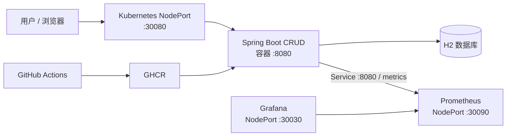

# Spring Boot Maven CRUD Example

[English](README.md) | [简体中文](README.zh-CN.md)

这是一个用于练习 GitHub Actions CI/CD 的 Spring Boot CRUD 项目。应用提供
`Product` 的增删改查接口，使用 H2 内存数据库，因此不需要单独安装 MySQL等数据库。

## 目录

- [技术栈](#技术栈)
- [系统架构](#系统架构)
- [本地运行](#本地运行)
- [API](#api)
- [部署方式](#部署方式)
- [建议硬件配置](#建议硬件配置)
- [GitHub Actions CI/CD](#github-actions-cicd)
- [监控](#监控)
- [排障](#排障)

## 技术栈

- Java 8、Spring Boot 2.7
- Spring Web、Spring Data JPA、Bean Validation
- Spring Boot Actuator、Micrometer Prometheus
- H2、JUnit 5、MockMvc
- Docker、Docker Compose、Kubernetes
- GitHub Actions、GHCR

## 系统架构

本项目可以作为单服务器 all-in-one 完整运行：应用、Prometheus 和 Grafana
部署在同一台主机上；Grafana 会自动配置 Prometheus 数据源，Prometheus
抓取应用的 `/actuator/prometheus` 指标接口。



Kubernetes 仍然是可选的容器编排方式。在单台 Docker 主机上，下面的监控
安装脚本具备幂等性：只在需要时安装 Docker，并复用已有的 Prometheus、
Grafana 容器和持久化卷。

## 本地运行

要求：Java 8 和 Maven。

```bash
mvn spring-boot:run
```

应用默认监听 `8080`。默认 profile 是 `local`，Swagger UI 和 OpenAPI 文档地址为：

- http://localhost:8080/swagger-ui.html
- http://localhost:8080/v3/api-docs

选择其他 profile：

```bash
mvn spring-boot:run -Dspring-boot.run.profiles=dev
mvn spring-boot:run -Dspring-boot.run.profiles=test
java -jar target/product-crud-0.0.1-SNAPSHOT.jar --spring.profiles.active=prod
```

profile 说明：

| Profile | 用途 | Swagger |
| --- | --- | --- |
| `local` | 本地开发，H2 | 开启 |
| `dev` | 共享开发环境 | 开启 |
| `test` | 自动化测试 | 开启 |
| `staging` | 类生产环境 | 关闭 |
| `prod` | 生产部署 | 关闭 |

完整校验命令会运行测试、Checkstyle、SpotBugs 和 PMD：

```bash
mvn clean verify
```

## API

| 方法 | 路径 | 说明 |
| --- | --- | --- |
| GET | `/api/products` | 查询全部产品 |
| GET | `/api/products/{id}` | 查询单个产品 |
| POST | `/api/products` | 创建产品 |
| PUT | `/api/products/{id}` | 更新产品 |
| DELETE | `/api/products/{id}` | 删除产品 |

创建或更新请求示例：

```json
{
  "name": "Keyboard",
  "price": 99.90,
  "description": "Mechanical keyboard"
}
```

校验规则：`name` 必填且最多 100 个字符，`price` 必须大于 0，
`description` 最多 500 个字符。

## 部署方式

| 方式 | 入口文件 | 运行时 | 适用场景 |
| --- | --- | --- | --- |
| 手动 JAR | `scripts/manual/` | Java + systemd | 学习主机进程部署 |
| Docker | `deployment/docker/`、`scripts/docker/` | Docker Compose | 单机容器部署 |
| Kubernetes | `deployment/kubernetes/`、`scripts/kubernetes/` | Deployment + NodePort | 滚动发布和容器编排 |
| 监控 | `deployment/monitoring/`、`scripts/monitoring/` | Prometheus + Grafana | 单机监控和可视化 |

Docker 镜像由 GitHub Actions 构建并推送到 GHCR。Docker 和 Kubernetes
都使用不可变的 `sha-<commit>` 标签，不会在部署主机重新编译代码。

### 1. 手动 JAR

```bash
mvn clean package -DskipTests
scp target/product-crud-0.0.1-SNAPSHOT.jar <user>@<vm>:/home/<user>/app/
scp scripts/manual/deploy.sh scripts/manual/product-crud.service <user>@<vm>:/home/<user>/app/
ssh <user>@<vm> 'bash /home/<user>/app/deploy.sh /home/<user>/app'
```

检查服务：

```bash
sudo systemctl status product-crud
sudo journalctl -u product-crud -f
```

### 2. Docker Compose

本地运行：

```bash
docker compose -f deployment/docker/docker-compose.yml up --build -d
docker compose -f deployment/docker/docker-compose.yml logs -f product-crud
docker compose -f deployment/docker/docker-compose.yml down
```

新 Ubuntu Docker 主机执行一次：

```bash
sudo bash scripts/docker/install-docker-ubuntu.sh
```

该脚本可重复执行：已安装的 apt 包会跳过，Docker 仓库和服务会复用；
用户重新登录后才会获得 docker group 权限。

### 3. Kubernetes 单机或多节点

Kubernetes 节点使用 **containerd**，不需要 Docker。推荐只安装 Kubernetes
脚本；如果同一台机器还需要 Docker Compose，才额外安装 Docker。两者都安装时，
Docker 的 `containerd.io` 可能替换系统 containerd，安装后必须确认
`systemctl status containerd kubelet` 均正常。

#### 单机 control-plane + worker（推荐学习环境）

在将作为 CI SSH 目标的 Ubuntu 用户下，先把仓库复制到服务器，然后执行：

```bash
sudo bash scripts/kubernetes/install-kubernetes-ubuntu.sh --init-control-plane
kubectl get nodes
kubectl get pods -A
```

脚本会安装 containerd、kubeadm、kubelet、kubectl 和 Flannel，初始化集群，
并移除 control-plane 的 `NoSchedule` 污点，使同一节点可以运行应用。
脚本是幂等的：已安装的依赖不会重复安装，已有 `/etc/kubernetes/admin.conf`
时不会再次执行 `kubeadm init`，可以安全重跑。CI 部署时，如果集群不可访问，
新服务器会自动按单机模式初始化。

如果只准备节点但不初始化集群：

```bash
sudo bash scripts/kubernetes/install-kubernetes-ubuntu.sh
```

多节点时，在 control-plane 上执行初始化命令并保存输出的 `kubeadm join ...`
命令，再在 worker 上安装依赖后执行该 join 命令。多节点 worker 不应移除调度污点。

安装前提和注意事项：

- Ubuntu、apt、systemd；脚本必须通过 `sudo` 执行。
- SSH 用户必须具备免密码 `sudo`；已有多节点集群还必须为该用户配置可用的
  `kubectl cluster-info` 上下文。
- Kubernetes 与 Flannel 使用默认 Pod 网段 `10.244.0.0/16`，如有冲突可设置
  `POD_NETWORK_CIDR`。
- 默认 Kubernetes 软件源为 `v1.30`，可通过 `K8S_MINOR_VERSION=v1.31` 修改。
- 脚本会关闭 swap，并配置 bridge filtering、IPv4 forwarding 和 systemd cgroup。
- 云安全组和 Ubuntu 防火墙至少需要允许 SSH；访问应用还需允许 TCP `30080`。

验证：

```bash
kubectl config current-context
kubectl cluster-info
kubectl get nodes -o wide
kubectl get pods -A
systemctl status containerd kubelet --no-pager
```

#### 手动部署 Kubernetes 应用

部署脚本会创建 namespace、GHCR pull secret、Deployment 和 Service：

```bash
export GHCR_USERNAME=<github-username>
export GHCR_TOKEN=<read-packages-pat>
bash scripts/kubernetes/deploy-kubernetes.sh \
  /home/<user>/app ghcr.io/<owner>/<repo>:sha-<commit>
```

CI 部署时，如果服务器没有安装 `kubectl`，或者 `kubectl` 无法连接集群，
部署脚本会自动使用免密码 `sudo` 执行
`install-kubernetes-ubuntu.sh --init-control-plane`。在新服务器上，这会
初始化单节点集群、安装 Flannel、为 SSH 用户复制 kubeconfig，并移除
control-plane 污点。已有 `/etc/kubernetes/admin.conf` 时不会重复初始化。
如果是已有多节点集群，应先为 SSH 用户配置并验证 `~/.kube/config`，不要
依赖自动单机初始化。

Kubernetes 部署会根据分支传入 Spring profile：`dev` 使用 `dev`，
`staging` 使用 `staging`，`main` 使用 `prod`。

`GHCR_TOKEN` 至少需要 `read:packages`。不要把短生命周期的
`GITHUB_TOKEN` 当作节点长期使用的 pull secret。

#### 访问 Kubernetes 服务

Service 使用 NodePort `30080`。将 `<K8S_VM_IP>` 替换为节点公网或内网 IP：

```bash
curl http://<K8S_VM_IP>:30080/actuator/health
curl http://<K8S_VM_IP>:30080/api/products
```

如果公网无法访问，检查云平台安全组和主机防火墙：

```bash
sudo ufw allow 30080/tcp
kubectl -n product-crud get service product-crud
kubectl get nodes -o wide
```

### 4. Prometheus 和 Grafana 监控

Kubernetes 部署会通过 `scripts/kubernetes/deploy-kubernetes.sh` 直接创建
监控资源，不会在 Kubernetes 节点安装 Docker。工作流从 GitHub Environment
Secret 读取 `GRAFANA_ADMIN_PASSWORD`，创建或更新 Kubernetes Secret，然后
应用 `deployment/kubernetes/monitoring.yml`。Prometheus 抓取集群内部的
`product-crud:8080` Service，不依赖外部 NodePort。

Prometheus 地址是 `http://<K8S_VM_IP>:30090`，Grafana 地址是
`http://<K8S_VM_IP>:30030`，应用地址仍是
`http://<K8S_VM_IP>:30080`。Deployment、Service、ConfigMap 和 Grafana
Secret 每次部署都会幂等更新。本学习配置使用 `emptyDir` 保存监控数据，
Pod 删除后 Prometheus 历史数据和 Grafana 数据会丢失。由于这是单节点学习
集群，监控 Deployment 使用 `Recreate` 策略，会先停止旧 Pod 再启动新 Pod；
请只向可信网络开放 `30030` 和 `30090`。

部署会自动创建 **Product CRUD / Spring Boot** 看板，包含请求速率、
HTTP 5xx 比例、P95 延迟、JVM 堆内存、CPU 和线程数等面板。Prometheus
还会加载目标不可用、HTTP 5xx 比例过高、JVM 堆内存过高三类告警规则。
这些规则可以在 **Prometheus -> Alerts** 查看；本学习项目暂未加入
Alertmanager 或外部通知渠道。

## 建议硬件配置

以下配置适合学习或小型内部 all-in-one 部署，假设一个应用实例、H2 数据库、
Prometheus 保留 15 天数据，以及较少的 Grafana 看板访问量。

| 用途 | CPU | 内存 | 存储 | 网络 |
| --- | --- | --- | --- | --- |
| 最低 / 演示 | 2 vCPU | 4 GB RAM | 30 GB SSD | 5 Mbps |
| 推荐 / 小团队 | 4 vCPU | 8 GB RAM | 80 GB SSD | 10 Mbps |
| 较高流量 | 8 vCPU | 16 GB RAM | 150+ GB SSD | 50 Mbps |

建议使用 SSD，并至少保留 20% 空间给容器镜像层、Prometheus 数据和日志。
生产环境应使用外部数据库，最好将监控与应用拆分到不同主机，并根据实际
指标采样速率和保留周期规划 Prometheus 存储容量。

## GitHub Actions CI/CD

工作流文件是 `.github/workflows/cicd.yml`，分支与环境的对应关系如下：

| 分支 | GitHub Environment | 行为 |
| --- | --- | --- |
| `dev` | `development` | Pull request 执行 CI；push 构建、推送镜像并部署 |
| `staging` | `staging` | Pull request 执行 CI；push 构建、推送镜像并部署 |
| `main` | `production` | Pull request 执行 CI；push 构建并推送镜像，部署前等待环境审批 |

Pull request 不会触发部署。请在 **Settings -> Environments ->
production** 中配置 Required reviewers；这样部署 job 会在生产部署前暂停，
直到授权 reviewer 批准。建议在三个 environment 中分别配置同名的环境级
secrets，让每个环境使用各自的主机和 GHCR 凭据。手动运行仍可选择
Kubernetes 或 Docker。

请在每个 GitHub Environment 中配置以下 secrets（使用相同名称，workflow
会根据目标分支读取对应环境的值）：

| Secret | 用途 |
| --- | --- |
| `K8S_VM_IP`、`K8S_VM_USER`、`K8S_VM_KEY` | Kubernetes SSH |
| `K8S_GHCR_USERNAME`、`K8S_GHCR_TOKEN` | Kubernetes 拉取 GHCR 镜像 |
| `DOCKER_VM_IP`、`DOCKER_VM_USER`、`DOCKER_VM_KEY` | Docker Compose SSH |
| `GRAFANA_ADMIN_PASSWORD` | 监控部署使用的 Grafana 管理员密码 |

`publish` job 使用 Actions 自动提供的 `GITHUB_TOKEN` 推送镜像；
Kubernetes 节点使用单独的 `K8S_GHCR_TOKEN` 拉取镜像。private GHCR package
需要 PAT 具备 `read:packages`，组织启用 SSO 时还要对 PAT 授权 SSO。

CI 失败时先在目标主机检查：

```bash
kubectl -n product-crud get deployment,pods,events --sort-by=.lastTimestamp
kubectl -n product-crud describe pod -l app=product-crud
kubectl -n product-crud logs -l app=product-crud --all-containers=true --tail=200
```

常见状态：

- `ImagePullBackOff`：GHCR 凭据、镜像权限或镜像标签错误。
- `Pending`：节点不可调度、资源不足或 control-plane 污点未移除。
- `CrashLoopBackOff`：应用启动失败，查看容器日志。
- `Running` 但 `0/1 Ready`：检查 `/actuator/health/readiness` 和应用日志。

## 监控

GitHub Actions 会在应用部署后自动应用
`deployment/kubernetes/monitoring.yml`。请在每个 GitHub Environment
（`development`、`staging`、`production`）中配置
`GRAFANA_ADMIN_PASSWORD` Secret，不需要登录服务器手动设置密码。
应用容器内部监听 `8080`，Prometheus 通过 Kubernetes Service DNS
`product-crud:8080` 抓取指标，应用对外 NodePort 仍为 `30080`。静态抓取
示例如下：

```yaml
scrape_configs:
  - job_name: product-crud
    metrics_path: /actuator/prometheus
    static_configs:
      - targets: ["product-crud:8080"]
```

在 Prometheus 的 **Status -> Targets** 确认 target 为 `UP`，再打开
**Product CRUD** 文件夹中的自动创建看板。常用 PromQL 示例：

```promql
sum(rate(http_server_requests_seconds_count{job="product-crud"}[5m]))
histogram_quantile(0.95, sum by (le) (rate(http_server_requests_seconds_bucket{job="product-crud"}[5m])))
sum(jvm_memory_used_bytes{job="product-crud",area="heap"})
up{job="product-crud"}
```

生产环境应限制 metrics endpoint 只允许监控主机访问。

## 排障

### `kubectl` 无法连接集群

```bash
kubectl config current-context
kubectl cluster-info
kubectl get nodes
```

确认命令是以配置了 `~/.kube/config` 的 SSH 用户执行，而不是 root 或另一个用户。

### `ImagePullBackOff`

```bash
kubectl -n product-crud get secret ghcr-credentials
kubectl -n product-crud describe pod -l app=product-crud
kubectl -n product-crud get deployment product-crud \
  -o=jsonpath='{.spec.template.spec.containers[0].image}{"\n"}'
```

确认 Secret 存在于同一个 namespace，PAT 具备 `read:packages`，且镜像标签已在
GHCR 发布。

### `progress deadline exceeded`

这只是 Deployment 没有在超时时间内出现 Ready Pod 的汇总错误。查看 Pod 事件、
容器日志和节点状态，不要单纯增加 timeout：

```bash
kubectl -n product-crud describe deployment product-crud
kubectl -n product-crud describe pod -l app=product-crud
kubectl get nodes
```
